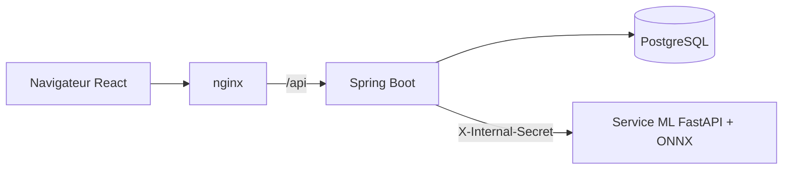

# Pneumonia

Application web d'**aide à la décision** pour la détection de pneumonie sur radiographie thoracique : un modèle ONNX estime la probabilité de pneumonie, propose un type (bactérienne ou virale) et produit une carte de chaleur Grad-CAM. Les résultats sont rattachés à un dossier patient, relus par un médecin et exportables en PDF.

> **Avertissement.** Cet outil ne constitue pas un diagnostic et ne remplace pas le jugement d'un professionnel de santé. Le modèle a été entraîné sur des radiographies pédiatriques (1 à 5 ans) d'un seul centre : sa fiabilité sur d'autres populations n'est pas établie. Les pistes de prise en charge affichées sont des rappels généraux, sans posologie, à faire valider par un médecin avant tout usage réel.

## Sommaire

- [Fonctionnalités](#fonctionnalités)
- [Architecture](#architecture)
- [Structure du projet](#structure-du-projet)
- [Démarrage rapide (Docker)](#démarrage-rapide-docker)
- [Configuration](#configuration)
- [Développement local](#développement-local)
- [API](#api)
- [Service ML](#service-ml)
- [Sécurité](#sécurité)
- [Tests et CI](#tests-et-ci)
- [Limites connues](#limites-connues)

## Fonctionnalités

**Analyse**
- Envoi d'une radiographie (PNG ou JPEG, 10 Mo max) : probabilité de pneumonie, étiquette `NORMAL` / `PNEUMONIA`.
- Type estimé (`BACTERIAL`, `VIRAL` ou `UNDETERMINED` si la confiance est trop faible), évalué seulement en cas de pneumonie.
- Carte de chaleur Grad-CAM superposée à l'image.
- Constantes cliniques associées à l'analyse : température, SpO₂, durée des symptômes.
- Pistes de prise en charge selon le type estimé, avec signes d'alerte et limites du modèle.
- Version du modèle enregistrée avec chaque analyse.

**Suivi médical**
- Dossiers patients : création, modification, archivage, suppression, liste paginée.
- Avis du médecin sur chaque analyse (d'accord / pas d'accord, avec commentaire), pour mesurer la concordance avec le modèle.
- Comparaison de plusieurs analyses pour suivre l'évolution.
- Export PDF d'une analyse et export PDF du dossier patient complet.
- Tableau de bord avec statistiques.

**Administration**
- Inscription validée par un administrateur : un nouveau compte est désactivé tant qu'il n'est pas approuvé.
- Liste des utilisateurs, activation et désactivation de comptes.
- Journal d'audit réservé à l'administrateur, vue de toutes les analyses.

## Architecture



| Service | Rôle | Technologies |
|---|---|---|
| `frontend` | Interface web, servie par nginx (port 8081) | React 19, TypeScript, Vite, React Router |
| `pneumonia` | API métier, authentification, PDF, audit | Java 21, Spring Boot 4, Spring Security, JPA, Flyway, OpenPDF |
| `ml-service-onnx` | Inférence, Grad-CAM, typage | Python 3.12, FastAPI, onnxruntime, OpenCV |
| `db` | Données | PostgreSQL 17 |

## Structure du projet

```
.
├── docker-compose.yml
├── frontend/                 SPA React (pages, composants, client API, tests Vitest)
├── pneumonia/                Backend Spring Boot
│   └── src/main/
│       ├── java/com/example/pneumonia/
│       │   ├── controller/   Auth, Patient, Analysis, Admin, Insights
│       │   ├── service/      Analysis, PDF, audit, rate limiting, recommandations…
│       │   ├── config/       SecurityConfig, OriginCheckFilter, AdminSeeder
│       │   ├── ml/           client du service ML
│       │   └── entity/, repository/, dto/
│       └── resources/db/migration/   migrations Flyway (V1 à V5)
├── ml-service-onnx/          Service d'inférence
│   ├── app.py                API FastAPI
│   ├── typing_logic.py       interprétation des sorties des deux modèles
│   ├── pneumonia.onnx        modèle de détection
│   ├── type.onnx             modèle de type (optionnel)
│   └── dense_weights.npy     poids de la couche finale, utilisés pour le Grad-CAM
└── .github/workflows/ci.yml
```

## Démarrage rapide (Docker)

Prérequis : Docker et Docker Compose.

```bash
git clone https://github.com/omrani-wiem/pneumonie_complete_app.git
cd pneumonie_complete_app
```

Créer un fichier `.env` à la racine (il est ignoré par Git) :

```env
POSTGRES_PASSWORD=un-mot-de-passe-solide
ML_SHARED_SECRET=un-secret-partage-de-16-caracteres-minimum
JWT_SECRET=un-secret-jwt-de-32-caracteres-minimum
ADMIN_EMAIL=admin@example.com
ADMIN_PASSWORD=MotDePasse#2025
```

Puis lancer la stack :

```bash
docker compose up --build
```

Ouvrir <http://localhost:8081> et se connecter avec le compte administrateur défini dans `.env`.

Pour générer des secrets aléatoires :

```bash
openssl rand -base64 48
```

## Configuration

### Variables du `docker-compose.yml`

| Variable | Obligatoire | Description |
|---|---|---|
| `POSTGRES_PASSWORD` | oui | Mot de passe de la base |
| `ML_SHARED_SECRET` | oui | Secret partagé entre Spring et le service ML (16 caractères minimum) |
| `JWT_SECRET` | oui | Secret de signature des jetons (32 caractères minimum) |
| `ADMIN_EMAIL`, `ADMIN_PASSWORD` | oui | Compte administrateur créé au démarrage s'il n'existe pas |
| `ML_MODEL_VERSION` | non | Version du modèle, enregistrée avec chaque analyse |

Le mot de passe doit respecter la politique : 10 caractères minimum, avec au moins une lettre, un chiffre et un caractère spécial.

### Variables avancées du backend

| Variable | Défaut | Description |
|---|---|---|
| `DB_URL`, `DB_USER`, `DB_PASSWORD` | H2 en mémoire | Connexion à la base |
| `ML_URL` | `http://localhost:7860` | URL du service ML |
| `CORS_ALLOWED_ORIGINS` | vide | Origines autorisées, séparées par des virgules |
| `COOKIE_SECURE` | `false` | À passer à `true` en HTTPS |
| `COOKIE_SAMESITE` | `Lax` | Politique SameSite du cookie |
| `FORWARD_HEADERS` | `none` | Mettre `framework` derrière un proxy de confiance pour voir la vraie IP |
| `LOGIN_MAX_ATTEMPTS` | `5` | Échecs avant blocage |
| `LOGIN_LOCKOUT_MINUTES` | `15` | Durée du blocage |
| `ANALYSIS_MAX_PER_MINUTE` | `10` | Analyses par minute et par utilisateur |
| `H2_CONSOLE` | `false` | Console H2 (développement uniquement) |

### Service ML

| Variable | Défaut | Description |
|---|---|---|
| `ML_SHARED_SECRET` | obligatoire | Même valeur que côté backend |
| `TYPE_MODEL_PATH` | `type.onnx` | Chemin du modèle de type (optionnel) |
| `TYPE_MIN_CONF` | `0.75` | Confiance minimale pour afficher un type |
| `ALLOWED_ORIGINS` | vide (CORS fermé) | Le service n'est appelé que par le backend |

## Développement local

Sans Docker, la base par défaut est H2 en mémoire.

```bash
# 1. Service ML
cd ml-service-onnx
pip install -r requirements.txt
ML_SHARED_SECRET=un-secret-de-16-caracteres uvicorn app:app --port 7860

# 2. Backend
cd pneumonia
export JWT_SECRET=un-secret-jwt-de-32-caracteres-minimum
export ML_SHARED_SECRET=un-secret-de-16-caracteres
export ADMIN_EMAIL=admin@example.com ADMIN_PASSWORD='MotDePasse#2025'
./mvnw spring-boot:run

# 3. Frontend
cd frontend
npm ci
npm run dev
```

En développement, le frontend appelle le backend sur `http://localhost:8080` (`frontend/.env.development`). Ajouter l'origine du serveur Vite (`http://localhost:5173`) à `CORS_ALLOWED_ORIGINS`. En production, `VITE_API_URL` est vide : nginx relaie `/api` vers le backend.

## API

| Méthode | Route | Accès | Description |
|---|---|---|---|
| POST | `/api/auth/register` | public | Inscription (compte désactivé jusqu'à validation) |
| POST | `/api/auth/login` | public | Connexion, cookie httpOnly |
| POST | `/api/auth/logout` | public | Déconnexion |
| GET | `/api/patients` | utilisateur | Liste paginée (`page`, `size` jusqu'à 100) |
| GET, PUT, DELETE | `/api/patients/{id}` | utilisateur | Consulter, modifier, supprimer |
| PUT | `/api/patients/{id}/archived` | utilisateur | Archiver |
| GET | `/api/patients/{id}/analyses` | utilisateur | Analyses d'un patient |
| GET | `/api/patients/{id}/export` | utilisateur | Dossier patient en PDF |
| GET | `/api/analyses/{id}` | utilisateur | Détail d'une analyse |
| PUT | `/api/analyses/{id}/opinion` | utilisateur | Avis du médecin (`AGREE` / `DISAGREE`) |
| GET | `/api/analyses/{id}/pdf` | utilisateur | Rapport PDF |
| GET | `/api/analyses/compare` | utilisateur | Comparaison d'analyses |
| GET | `/api/stats` | utilisateur | Statistiques du tableau de bord |
| GET | `/api/admin/users` | admin | Liste des comptes |
| PUT | `/api/admin/users/{id}/enabled` | admin | Activer ou désactiver un compte |
| GET | `/api/admin/audit` | admin | Journal d'audit |
| GET | `/api/admin/analyses` | admin | Toutes les analyses |

## Service ML

Le service fonctionne en cascade :

1. Le modèle de détection renvoie `P(pneumonie)` ; l'étiquette est `PNEUMONIA` à partir de 0,5.
2. Si pneumonie et si `type.onnx` est présent, le modèle de type renvoie `P(virale)`. Sous le seuil `TYPE_MIN_CONF`, le type est `UNDETERMINED` plutôt que forcé. Sans modèle de type, le type reste `null`.
3. Le Grad-CAM est calculé à partir des cartes de caractéristiques et des poids de la couche finale, puis superposé à l'image.

Endpoints :

| Route | Description |
|---|---|
| `GET /` | Santé du service, indique si le typage est actif |
| `POST /predict` | Image en `multipart/form-data`, en-tête `X-Internal-Secret` obligatoire |

## Sécurité

- Authentification par JWT (HS256) dans un cookie **httpOnly**, API stateless. Le jeton peut aussi être envoyé en en-tête `Authorization`.
- Protection CSRF assurée par `SameSite` et un filtre de vérification d'origine (`OriginCheckFilter`).
- Mots de passe hachés avec BCrypt, politique de complexité, comptes désactivés par défaut jusqu'à validation par un administrateur.
- Blocage temporaire après des échecs de connexion répétés, limitation de débit sur les analyses.
- Compte administrateur créé depuis l'environnement ; un compte existant n'est jamais promu.
- Validation des uploads côté backend, puis côté ML : formats PNG/JPEG, taille maximale, limite de pixels contre les « decompression bombs ».
- Le service ML n'est pas exposé au navigateur : appel serveur à serveur protégé par un secret partagé, comparé en temps constant.
- En-têtes de sécurité (CSP, `X-Frame-Options`, `Referrer-Policy`, `nosniff`) côté Spring et nginx.
- Journal d'audit des actions sensibles (inscription, connexion, avis médecin, etc.).
- Schéma de base géré par Flyway, `ddl-auto=validate`.

## Tests et CI

```bash
cd pneumonia && ./mvnw test            # backend (intégration : authentification, droits d'accès, analyses)
cd frontend && npm test                # frontend (Vitest)
cd ml-service-onnx && pytest test_typing_logic.py
```

GitHub Actions lance trois jobs à chaque push et pull request : tests backend (Java 21), tests et build du frontend (Node 22), tests du service ML (Python 3.12).

## Limites connues

- Modèle entraîné sur des radiographies pédiatriques d'un seul centre : performances non établies sur les adultes ou d'autres équipements.
- Le type bactérien ou viral est difficile à établir sur une image seule, même pour un radiologue : il reste indicatif.
- La limitation de débit des analyses est en mémoire, donc valable pour une seule instance du backend.
- `COOKIE_SECURE` vaut `false` par défaut : à activer derrière HTTPS.
- Les images et cartes de chaleur sont stockées dans la base (heatmap en base64) : à déplacer vers un stockage objet à grande échelle.
